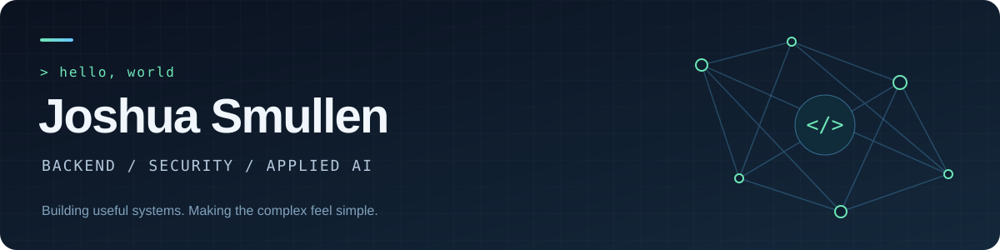

  

  
  
  

### Hey, I'm Josh 👋

I build backend systems, security tooling, and applications that connect AI to real work. I like turning complicated infrastructure into tools that are straightforward to use—from annotation-driven Spring libraries to natural-language interfaces.

I'm studying **Computer Science at Grove City College**, with a minor in **Machine Learning & Cyber Security**, graduating in **May 2027**.

- **My focus:** secure APIs, distributed systems, event-driven architecture, and AI agents.
- **My experience:** AI and security engineering at **Pennsylvania State Treasury**, and software engineering at **Eurofins**.
- **Away from the keyboard:** chess, investing, and finding the next interesting thing to build.

### Things I'm building

| Project | What it's about | Built with |
| :--- | :--- | :--- |
| **[AutoAuth](https://github.com/AutoSprings/AutoAuth)** | Annotation-driven authentication for Spring Boot, with JWTs, JWKS, key rotation, and token revocation. | Java · Spring Security · Redis |
| **[AutoLimit](https://github.com/AutoSprings/AutoLimit)** | An independent Spring Boot library for annotation-based endpoint quotas and IP rate limiting. | Java · Spring Boot · AOP |
| **[AutoAgent](https://github.com/JTSmullen/AutoAgent)** | A telemetry and agent-system project exploring event-driven ingestion, distributed security, and AI tooling. | Java · Kafka · PostgreSQL · Spring AI |
| **[Trading Strategy Backtester](https://github.com/JTSmullen/MCPStrategyBacktester)** | Describe a trading strategy in plain English and explore its historical performance with metrics and an interactive equity curve. | Python · Flask · Gemini · Backtrader |

### My toolkit

| Area | Technologies |
| :--- | :--- |
| **Languages** | Java · C# · TypeScript · Python · SQL · C · Swift |
| **Backend & web** | Spring Boot · Spring Security · Spring AI · .NET · Angular · Node.js |
| **Data & infrastructure** | PostgreSQL · Redis · Kafka · Docker · Azure · AWS · CI/CD |
| **Security & AI** | JWT / JWKS · IAM · Zero Trust · Model Context Protocol · Agent workflows |

<strong>A little more about my experience</strong>

- **Pennsylvania State Treasury · AI & Security Systems Engineer Intern · Summer 2026**  
  Worked on financial API security, automated cloud red-teaming, and identity and access management workflows.
- **Eurofins · Software Engineer Intern · Summer 2025**  
  Built an Azure-hosted MCP server for laboratory data systems, developed C#/.NET and Angular features, and optimized data-processing pipelines.

---

  <strong>See the projects, context, and more at <a href="https://portfolio.joshsmullen.com">portfolio.joshsmullen.com</a>.</strong>

